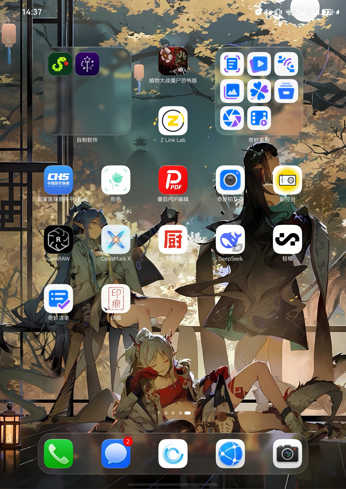

# 印痕 Yinhen

一款 HarmonyOS 拍照水印应用：读取照片 EXIF 拍摄参数，一键生成专业风格的相机水印图。

## 功能特性

- **EXIF 拍摄参数读取**：自动读取相机型号、镜头、焦距、光圈、快门、ISO、拍摄时间等信息
- **多选照片批量处理**：一次最多 20 张照片，逐张读取各自拍摄参数，支持一键批量导出
- **型号自动识别**：尼康 Z 系列（™ 含花体与罗马数字 Mark）、索尼 α 系列自动识别显示，支持中文品牌名
- **多种预设样式**：标准白框、拍立得、胶片、标签参数、台历、会展等预设一键应用
- **个人 Logo**：导入个人签名/徽标图片作为水印元素，自动生成黑白两版，可替换品牌 Logo 或署名
- **画幅比例裁切**：原图 / 1:1 / 4:3 / 3:4 / 16:9 / 9:16 六档画幅式中心裁切，预览所见即所得
- **导出保留元数据**：导出的水印照片完整继承原片 EXIF（含 HDR 照片），最高 4096px 原图输出
- **沉浸式 UI**：底部悬浮胶囊菜单、沉浸光感材质、平滑转场动画
- **折叠屏适配**：半折叠悬停时沿物理折痕分屏操作，横竖折痕均适配

## 下载安装

从 [Releases](https://github.com/Constantine1111/yinhen/releases) 下载最新的 `.hap` 安装包，通过 DevEco Studio 或 HDC 安装到 HarmonyOS 设备。

## 本地构建

1. 安装 [DevEco Studio](https://developer.huawei.com/consumer/cn/deveco-studio/)（HarmonyOS SDK 26）
2. 克隆本仓库并打开项目
3. `File → Project Structure → Signing Configs` 配置本地签名（默认已提供 Debug 自动签名）
4. 连接设备，点击 Run

技术栈：ArkTS / ArkUI（Stage 模型）

## 版本历史

详见 [版本更新日志](总结/版本更新日志.md)。

## 声明

本项目仅供学习交流使用，与上述各相机品牌及其厂商无任何关联；项目中出现的品牌名称与商标归其各自所有者所有，仅用于标识照片的拍摄器材。

## License

仅供学习交流使用。
